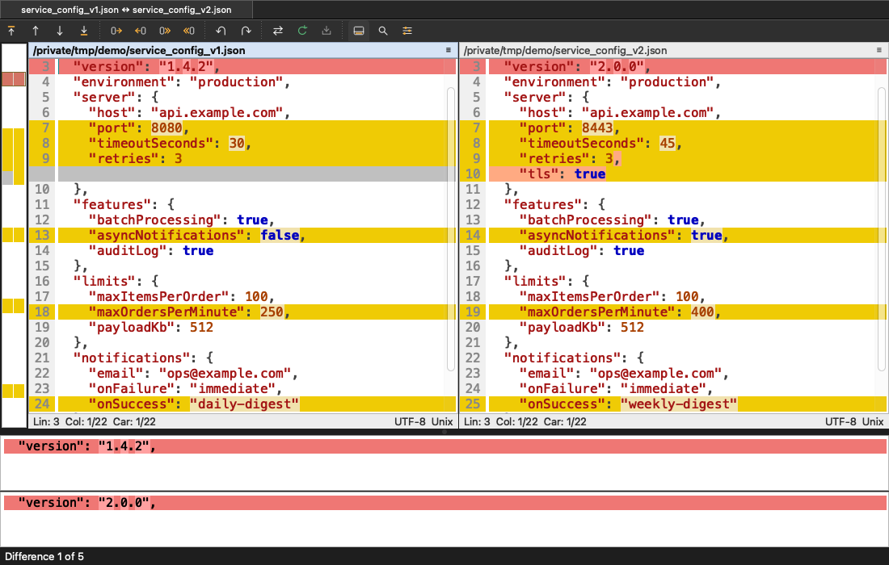
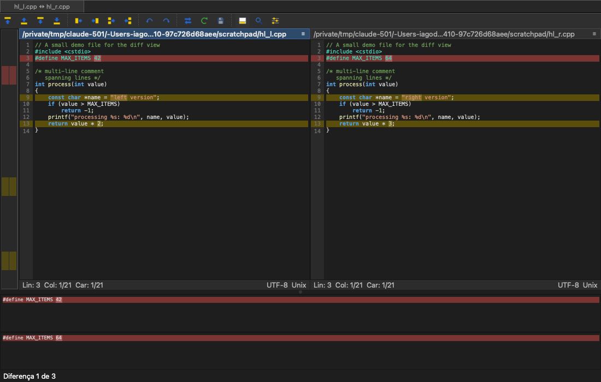
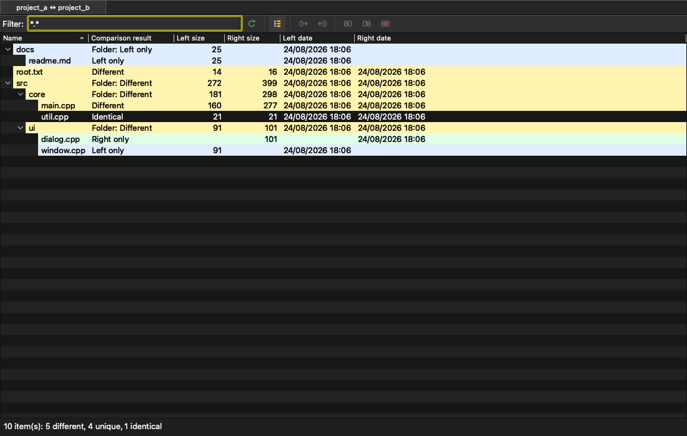
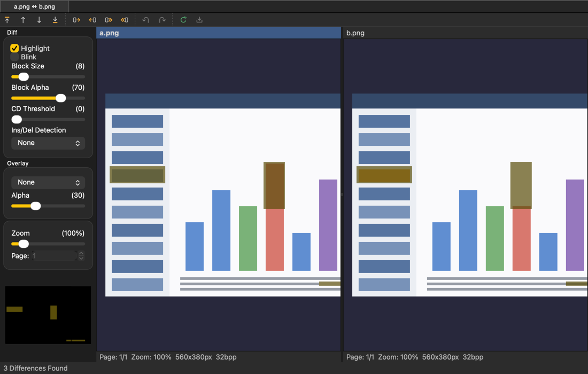
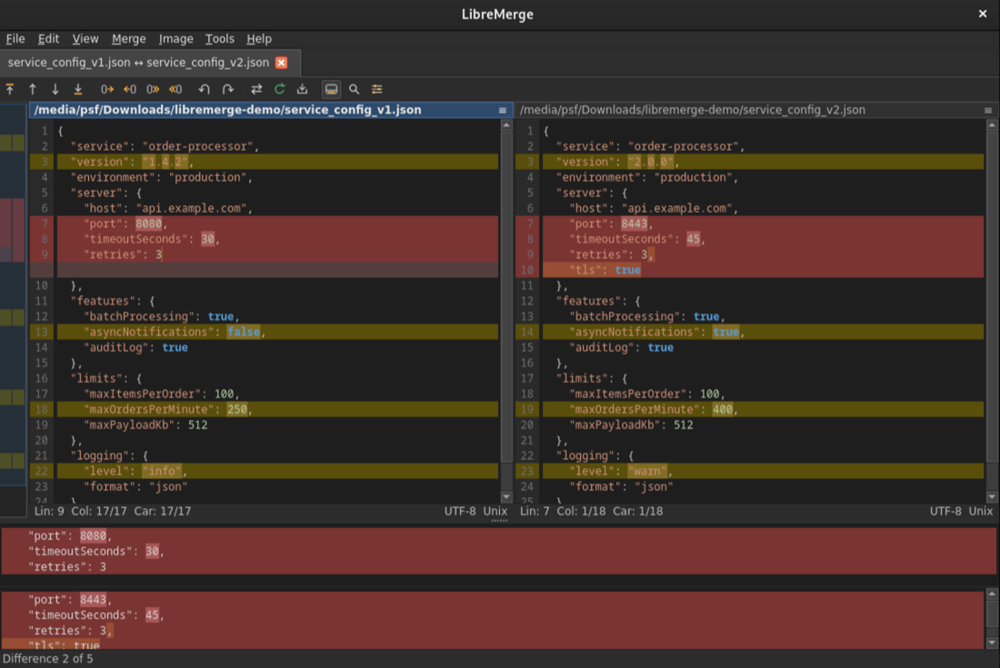

# LibreMerge

**A free, open-source differencing and merging tool for macOS (and Linux) — bringing the WinMerge experience beyond Windows.**

LibreMerge reuses the battle-tested comparison engine of [WinMerge](https://winmerge.org/) — GNU diffutils + git xdiff, folder scanning, file filters, moved-block detection, Unicode handling — and rebuilds the user interface natively with Qt 6, since the original UI is written in MFC and cannot leave Windows. If you know WinMerge, you already know LibreMerge: the layout, the colors and the workflow are intentionally the same.

📦 [Releases](https://github.com/iagodpassos/libremerge/releases) · ☕ [Buy me a coffee](https://buymeacoffee.com/iagodpassos)



## Features

- **Side-by-side file comparison and merging** (2-way and 3-way) with the classic WinMerge look: gold difference blocks, word-level highlights inside lines, gray filler keeping the panes aligned line by line
- **Free editing with live remerge**: type directly in the panes, copy differences (or all of them) in either direction, undo/redo, recompare with F5; Tab and Shift+Tab indent and unindent the selected lines, with tabs or spaces and the tab size of WinMerge's Options > Editor; files are saved with their original encoding, BOM and line endings preserved (each line's own in a file whose lines end in more than one way, and in every file with WinMerge's Preserve original EOL in Options > Editor); line endings count in the comparison, and files whose lines end otherwise bring up WinMerge's question to treat them as the same
- **Folder comparison** (2-way and 3-way) with a hierarchical tree or flat list, background scanning with progress and cancel, file masks / regex / expression filters, copy between sides and delete to Trash (every pairwise direction in 3-way, from the context menu); a file on one side only opens against an empty untitled pane, as in WinMerge; two selected files with different names (three in 3-way) compare with each other through Compare or Enter, and Compare Non-horizontally picks the sides of two; the 3-way view marks which pair stayed identical on each difference, like WinMerge. Without "Include subfolders" (on the selection screen) only the top folders' items are compared: a subfolder opens in the same window and ".." goes back up, as in WinMerge. WinMerge's seven compare methods (full, quick or binary contents, modified date, date and size, size, existence), switched from the status bar, and its View menu filters to show or hide identical, different, unique, skipped or binary items
- **Archive comparison** (zip, 7z, tar and compressed tar, plus single-file gz/bz2/xz/zst): archives extract to temporary folders and open as a folder comparison, WinMerge style, against another archive or a plain folder, 2- or 3-way, with nested archives unwrapped automatically
- **Diff pane** showing the current difference per file, WinMerge's path bar over each pane in every comparison (copy the path or the file name, edit the caption or the path in place, open another file, the clipboard or a recent file in the pane), per-pane status bars (line/column, encoding, EOL), and WinMerge's **location pane**: the whole comparison at a glance, a click or a drag to move through it, and its menu with Go to Line and moved blocks; Edit > Go to (Ctrl+G) reaches a line of any file or a difference by its number
- **CSV/TSV table comparison** (2-way and 3-way) as side-by-side grids: cell editing (F2 or start typing) with undo, copies of whole differences or of the selected cells, cell-level difference highlighting, quoted fields (a quoted cell may run over several lines), first-row headers, columns left out of the comparison from the header's menu (in every file or in one, as WinMerge's Ignore This Column), and WinMerge's Options > Compare > Table to pick the files that open as tables (CSV, TSV or a delimiter of your own, by file pattern) with their delimiter and quote character
- **Image comparison** (2-way and 3-way) with WinMerge's own image-diff engine: block-level pixel differences with adjustable block size and color-distance threshold, insertion/deletion detection for shifted rows/columns, XOR and alpha-blend overlays, blink mode, wipe and rectangle-select dragging, multi-page navigation (animated GIF, multi-page TIFF), rotation/flips, copy between sides with undo, and a clickable difference minimap; WinMerge's Options > Compare > Image picks the image files by pattern and can compare images by their pixels in folder comparisons too
- **Binary comparison** (2-way and 3-way), after WinMerge's hex view: the files as hex dumps side by side, each byte that differs at the same offset colored, next and previous difference, the selected bytes or all of them copied across, and the editing of the hex editor WinMerge embeds (overwrite or insert, by hex digit or by character, Cut, Copy and Paste, Find and Replace in Frhed's special syntax, Go to offset) with one undo history for the panes. Binary files and WinMerge's binary file patterns open it, and Options > Compare > Binary holds the editor's settings
- **WinMerge's filters**: Tools > Filters with its three pages, file filters (one global folder filter with masks, expressions and presets, picked from the selection screen and built with the "=" helper menu), line filters (regular expressions that mark matching differences as trivial) and substitution filters; a **display filter bar** in the folder window (by comparison result, or per column) and in the file and table windows (hide the lines a text or a line expression does not match, with the "=" menu to build one); and **moved block detection**
- **Find and Replace** in the compare panes with WinMerge's own dialogs: whole word, match case, regular expressions (their groups in the replacement), Replace All in a selection, F3 to search again, every occurrence of the text marked, and the Marker dialog for texts of your own marked in three colors
- **Syntax highlighting** as WinMerge colors files: its own parsers for 47 languages and Tree-sitter grammars for 23, the built-in parsers first by default (YAML, TOML, Markdown, TypeScript and properties files then come from Tree-sitter) or in the order picked in Options > Editor; "Ignore comment differences" knows the comments of all of them
- **Light and dark themes** for the whole window, or follow the system (on Linux, the dark style of GNOME and KDE, picked up as you switch it), chosen under Options > General; **English, Spanish, Catalan, French, German and Brazilian Portuguese** interface following the system language
- Drag & drop files or folders onto the window or the Dock icon; a WinMerge-style "Select Files or Folders" screen with history, paths verified as you type, auto completion, read-only flags and swap; a single file opens against a snapshot of itself, to review your own edits
- Comparison options carried over from WinMerge: ignore whitespace/case/blank lines/EOL/numbers, diff algorithm selection (Myers, minimal, patience, histogram)
- An **Options dialog laid out like WinMerge's**, with its General settings (close with Esc, preserve file times on save, verify paths, auto completion, reload of files changed by other applications), its Compare page (whitespace, case, blank lines, EOL, numbers, codepage and comment differences, moved blocks, indent heuristic, diff algorithm), its Message Boxes page, where notices such as "files are identical" can be hidden and brought back, and its Codepage page: the codepage files without a BOM read and save in (the system's UTF-8, the interface language's or a custom one), HTML/XML/.rc files read by the charset they declare, and an encoding detector (ICU's, where WinMerge has Windows' mlang)

| Dark theme | Folder comparison |
| --- | --- |
|  |  |

| Image comparison | On Linux (Debian/GNOME) |
| --- | --- |
|  |  |

## Install (macOS)

**Requirements**: macOS 14.4 (Sonoma) or later, Intel or Apple Silicon (universal binary). macOS 12 and 13 stay with [LibreMerge 0.9.9](https://github.com/iagodpassos/libremerge/releases/tag/v0.9.9), the last release that runs on them.

**Homebrew**:

```sh
brew install --cask iagodpassos/tap/libremerge
```

(Recent Homebrew asks you to trust third-party taps first: `brew trust iagodpassos/tap`.)

**Manual**: download `LibreMerge-<version>.dmg` from the [releases page](https://github.com/iagodpassos/libremerge/releases), open it and drag LibreMerge to Applications.

LibreMerge is not yet notarized by Apple, so the first launch needs one extra step: right-click the app → **Open** (or allow it under **System Settings → Privacy & Security**). If macOS still refuses ("app is damaged"), clear the download quarantine once:

```sh
xattr -d com.apple.quarantine /Applications/LibreMerge.app
```

You can also launch comparisons from the terminal:

```sh
LibreMerge left.txt right.txt          # 2-way file compare
LibreMerge base.txt mine.txt theirs.txt  # 3-way
LibreMerge dirA/ dirB/                 # folder compare
```

## Build from source (macOS / Linux)

Dependencies: a C++17 compiler, CMake ≥ 3.24, Ninja, Qt 6, POCO, ICU, Boost (headers), libarchive, re2c and lemon. The first configure downloads the sources of the Tree-sitter grammars WinMerge uses, about 12 MB (`-DLM_TREE_SITTER_GRAMMARS=OFF` builds without them). On macOS: `brew install cmake ninja qt poco icu4c boost googletest re2c lemon libarchive`. On Debian/Ubuntu see the package list in [`.github/workflows`](.github/workflows).

```sh
cmake -S . -B build -G Ninja
cmake --build build
ctest --test-dir build        # engine test suite (417 tests)
./build/app/LibreMerge        # (on macOS: build/app/LibreMerge.app)
```

## Install (Linux)

**AppImage** (recommended — any distro, x86_64 or arm64): download the `LibreMerge-<version>-<arch>.AppImage` for your architecture from the [releases page](https://github.com/iagodpassos/libremerge/releases), make it executable and run — Qt, ICU and Poco are bundled, nothing to install. Needs glibc 2.35+ (Debian 12+, Ubuntu 22.04+, Mint 21+, Fedora 36+, Arch):

```sh
chmod +x LibreMerge-<version>-x86_64.AppImage && ./LibreMerge-<version>-x86_64.AppImage
```

To add the AppImage to your applications menu (GNOME, KDE and others), run it once with `--install-desktop-integration`; it writes a menu entry pointing at the AppImage and its icons under `~/.local/share`, and `--remove-desktop-integration` takes them out again.

**Homebrew on Linux**: the same cask installs the AppImage for your architecture into `~/Applications`, adds it to the applications menu and puts a `libremerge` command on your PATH (glibc 2.35+ as above):

```sh
brew install --cask iagodpassos/tap/libremerge
```

**Arch Linux**: an AUR package is on the way. Meanwhile, `packaging/aur/PKGBUILD` in this repository builds and installs cleanly with `makepkg -si`.

Other formats (native .deb packages, Flatpak) come back if there is demand — open an issue if you need one and it moves up the list.

## Use with git

LibreMerge works as git's merge and diff tool. Conflicts open in the familiar three-pane layout, with the merged result in the middle pane.

**macOS**:

```sh
git config --global merge.tool libremerge
git config --global mergetool.libremerge.cmd \
  '/Applications/LibreMerge.app/Contents/MacOS/LibreMerge "$LOCAL" "$MERGED" "$REMOTE"'

git config --global diff.tool libremerge
git config --global difftool.libremerge.cmd \
  '/Applications/LibreMerge.app/Contents/MacOS/LibreMerge "$LOCAL" "$REMOTE"'
```

**Linux**: the same commands, with `libremerge` (or the path to the AppImage) in place of the full bundle path.

To use it, run `git mergetool` after a conflict: resolve it in the middle pane, save, and close the window. Two notes on the extra files you may see afterwards:

- LibreMerge writes a `.bak` copy next to the file it saves, which is WinMerge's default behavior. Turn it off under Options > Backup Files if you prefer.
- `git mergetool` itself keeps a `.orig` file unless you set `git config --global mergetool.keepBackup false`.

WinMerge's switches work in these commands too: for the merge tool, `-e -u -wl -wr -fm -dl Local -dm Merged -dr Remote` in front of the paths makes Esc close the window, keeps the files out of the recent comparisons, opens the outer panes read-only with the focus on the middle one, and names the three panes.

## Command line

LibreMerge reads WinMerge's command line, with `-` in front of each switch (`/` starts a path on macOS and Linux); `libremerge -?` lists the switches. For example:

```sh
libremerge -e -u -wl -dl "Base" -dr "Mine" base.txt mine.txt
```

These work today: the descriptions (`-dl`, `-dm`, `-dr`), read-only sides (`-wl`, `-wm`, `-wr`), the focus (`-fl`, `-fm`, `-fr`), `-e`, `-x` and `-xq`, `-u`, the window type (`-t`), the compare method (`-m`), the subfolders (`-r`, `-r-`), the file filter (`-f`), the line and character to go to (`-l`, `-c`), `-fileext`, the codepage (`-cp`), the table switches, the compare options (`-ignorews` and the like, and any option of the Options by WinMerge's name with `-cfg`), the output file (`-o`), `-noprefs`, `-inifile`, `-self-compare`, `-new`, `-minimize`, `-maximize` and `-show-dialog`. For scripts, `-noninteractive` answers every message box with Cancel (its text goes to the terminal) and closes once the comparison is done, without a window where Qt's offscreen platform is there, and `-enableexitcode` makes the exit code 0 for identical files or folders, 1 for different ones and 2 on an error:

```sh
libremerge -noninteractive -enableexitcode -noprefs old/ new/ && echo same
```

Not yet: `-or`, auto-merge (`-al`, `-am`, `-ar`) and plugins; LibreMerge says so on the terminal when it meets them. Windows' own switches for a single instance (`-s`, `-sw`, `-g`) are taken and have no effect: each run is a separate LibreMerge, which a caller waits for anyway.

## Known limitations

- Archive comparison works on extracted copies: edits are not packed back into the archive (WinMerge behaves the same)
- Image comparison: animated GIF and multi-page TIFF open and compare, but cannot be saved back (no Qt encoder — Save As offers PNG); SVG/PDF comparison is not supported yet
- Table comparison edits one cell at a time: splitting or joining cells and rows, which WinMerge does by editing the text, goes through Open as Text

## Support

If LibreMerge saves you time, you can [buy me a coffee](https://buymeacoffee.com/iagodpassos). ☕

## AI-assisted development

This port was built with the assistance of **Claude Fable 5**, an AI model by [Anthropic](https://www.anthropic.com): the engine portability layer, the Qt interface and the release tooling came out of AI-assisted pair-programming sessions. Everything that ships is validated against WinMerge's own engine test suite (357 tests) and an application selftest suite, on macOS and Linux CI.

## Relationship to WinMerge, license

LibreMerge is an independent port based on the comparison engine of [WinMerge](https://winmerge.org/), © Dean P. Grimm / Thingamahoochie Software and the WinMerge contributors, licensed GPL-2.0-or-later. Vendored engine sources keep their original headers; the port layer and the Qt application are new code. See [docs/VENDORED.md](docs/VENDORED.md) for the exact provenance and local-change policy.

LibreMerge as a whole is distributed under the **GNU GPL v3.0 or later** ([LICENSE](LICENSE)).

**LibreMerge is not affiliated with or endorsed by the WinMerge project.** The name and icon are original to this project.

## Roadmap

HTML reports and patch generation, notarized builds, Linux packages (AUR first), and — if it proves itself — offering the portable engine fixes back to WinMerge upstream ([WinMerge/winmerge#141](https://github.com/WinMerge/winmerge/issues/141) tracks the idea of a cross-platform UI).

Issues and pull requests are welcome. Everyone who helps is credited in [CONTRIBUTORS.md](CONTRIBUTORS.md), which the About box shows too.
